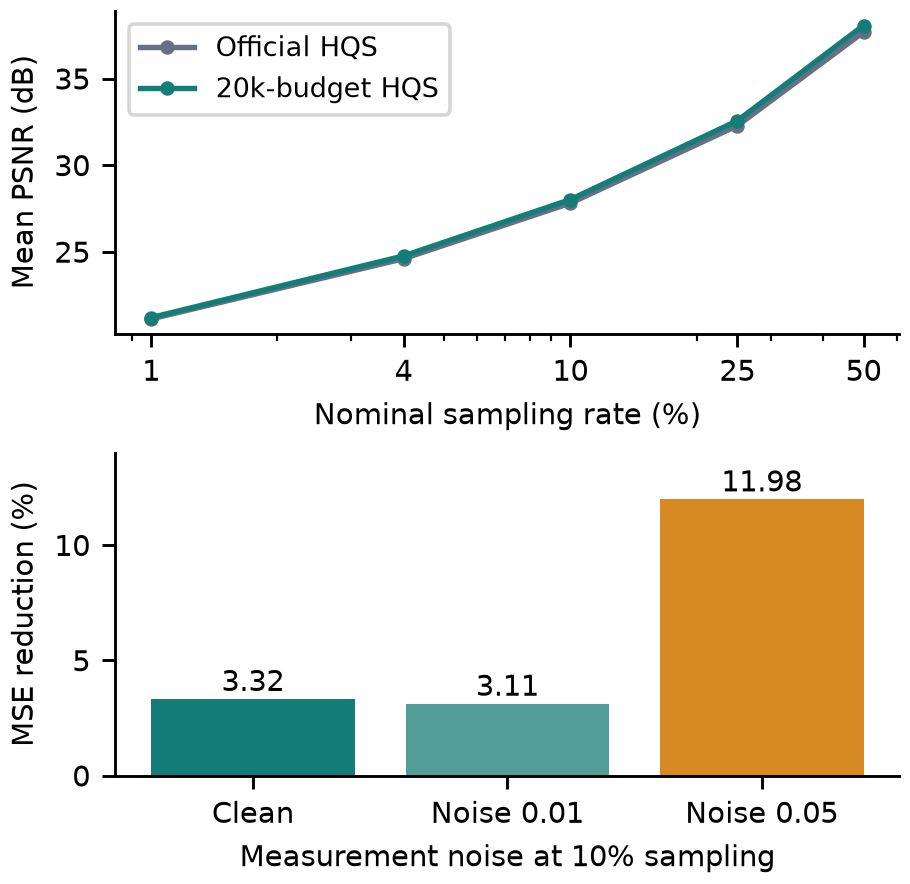
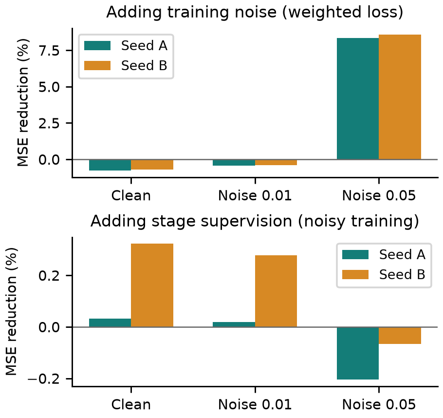
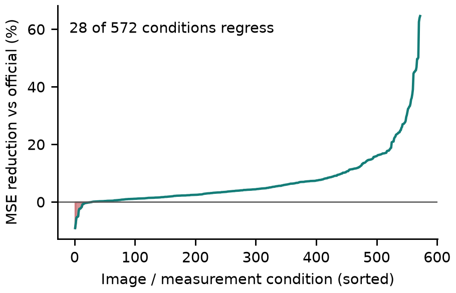

# Noise-Aware Single-Pixel Reconstruction: 20,000-Update HQS Adaptation and Training Ablations

Zicong Luo (522026230043), Shuhao Yang (502026230083), Yubowen Li (502026230092)

## Abstract

This report evaluates fixed-operator adaptation of the HQS variant of ProxUnroll for simulated single-pixel imaging. A 20,000-update fine-tuning budget is assessed against the official pretrained model, while a separate two-factor experiment tests measurement-noise augmentation and intermediate-stage supervision. On 52 DIV2K test images at 10% sampling, the validation-selected model reduces mean squared error by 3.32% for clean measurements and 11.98% for stronger measurement noise. The corresponding PSNR gains are 0.205 and 0.780 dB. A matched four-arm ablation, with two training seeds and 800 updates per arm, shows that noise augmentation improves noisy reconstruction but slightly compromises clean reconstruction; intermediate supervision produces much smaller, condition-dependent changes. These results support targeted noise robustness rather than uniformly improved reconstruction. The study uses grayscale simulation and makes no claim of physical-camera validation or a new network architecture.

## 1. Introduction

Single-pixel imaging reconstructs a spatial image from integrated responses to structured illumination or detection patterns [1]. Using fewer measurements than pixels reduces acquisition requirements but makes reconstruction underdetermined. Measurement consistency alone cannot determine the image, so the reconstruction algorithm must also use prior knowledge about natural images. This project studies that balance in a controlled software setting.

ProxUnroll combines a measurement-aware iterative update with a learned image restorer [2]. Starting from its official HQS weights, we investigate whether adaptation with fixed sensing operators improves reconstruction across sampling rates and noise levels. Keeping the operator fixed makes the comparison about the reconstruction model, without conflating it with a change in the measurement process.

The experiments address two questions. First, how does the model produced by a 20,000-update budget compare with the official model under identical measurements? Second, what are the separate effects of training noise and intermediate supervision during matched short-budget adaptation? The first comparison evaluates the final model; the second tests specific training choices. Their different initial states and budgets prevent treating the ablation as a decomposition of the final model's entire gain.

## 2. Reconstruction Model

## 2.1. Separable measurements

For a normalized grayscale image X with n rows and columns, the simulated measurement is

Y = H X W<super>T</super> + E.  (1)

H and W are row-selected sensing factors, and E is measurement noise. For nominal sampling ratio r, each factor uses m = ceil(n sqrt(r)) rows, so the realized ratio is m<super>2</super>/n<super>2</super>. At n = 256 and nominal 10% sampling, m = 81 and the realized ratio is approximately 10.011%. Reporting nominal ratios is convenient, but the same actual row counts are used for both models.

Noise entries are independent zero-mean Gaussian samples with standard deviation sigma times the RMS of the clean measurement. Thus sigma describes noise relative to measurement energy, not pixel-domain noise. The reconstruction receives Y and the sensing factors; the ground-truth image is used only to generate simulated data, train the model, and compute evaluation metrics.

## 2.2. Six-stage HQS reconstruction

The implementation initializes X0 = H<super>T</super>YW and performs six measurement-correction and restoration stages:

Zk = Xk + rhok H<super>T</super>(Y - H Xk W<super>T</super>)W, Xk+1 = Rtheta(Zk; memoryk).  (2)

The correction moves the estimate toward measurement consistency. The learned restorer combines convolution and window attention, passing feature memory between reconstruction stages within the same image. These are finite learned updates; their presence alone does not establish convergence or monotonic improvement of every intermediate reconstruction. All video frames in this study are processed independently.

## 2.3. Fine-tuning objective

All sensing factors remain frozen. The restorer and trainable reconstruction parameters are adapted using Adam, learning rate 10<super>-5</super>, batch size one, and single-precision arithmetic. Training samples a nominal ratio from [0.01, 0.04, 0.10, 0.10, 0.10, 0.25, 0.25, 0.50] and a relative noise level from [0, 0, 0.01, 0.05]. The repeated entries specify their sampling probabilities.

L = 0.01 sumk=1,...,5 RMSE(Xk, X) + 0.95 RMSE(X6, X).  (3)

This direct-ground-truth objective emphasizes the final reconstruction while adding a small loss at each intermediate stage. It is not the original paper's proximal-trajectory training objective. The project therefore evaluates an adaptation recipe for the released model, rather than a full reproduction of the original training method.

## 3. Experimental Protocol

## 3.1. Data and preprocessing

Training uses the 800 official DIV2K training images [3], with 16 separate images for validation and checkpoint selection. Training uses random square crops, area resizing, and horizontal and vertical flips. Split membership is defined by original image before augmentation, and source hashes are disjoint between the training, validation, and primary test splits.

The primary test set contains 52 DIV2K images. Additional evaluation uses 110 images: Kodak24, 32 DIV2K images, 18 campus photographs, 12 scenic photographs, and three spaced frames from each of eight HEVC sequences. The photographs are curated from external authors rather than captured by the team. Still images use the largest centered square, the OpenCV Y luminance channel, area resizing to 256 x 256, and normalization by 255. HEVC inputs use stored 8-bit Y values without an assumed studio-range conversion.

These test sets had already been examined during project development. Their results are comparisons on fixed inputs, not a newly blinded assessment. They do not select the final checkpoint or change the training recipe. Disjoint project splits also cannot establish whether public images appeared in the official model's upstream training.

## 3.2. Model selection and paired evaluation

The fine-tuning trajectory completes 20,000 optimizer updates. Validation selects the highest mean PSNR across 16 images, two sampling ratios (10% and 25%), and three noise levels (0, 0.01, and 0.05), subject to clean validation PSNR remaining within 0.03 dB of initialization. Under this fixed rule, step 19,500 is selected. We call it the 20k-budget model, and report the exact step-20,000 endpoint separately. The budget is not a claim that every additional update improves test quality.

The official model, selected model, and endpoint use identical images, sensing factors, and realized measurements. Clean evaluation covers nominal ratios of 1%, 4%, 10%, 25%, and 50%. Noisy evaluation uses 10% sampling, sigma = 0.01 or 0.05, and three matched measurement-noise realizations. This gives eleven measurement conditions per original image.

## 3.3. Metrics and aggregation

Predictions are clipped to [0, 1], and MSE, PSNR, and SSIM are computed before display-image quantization, with data range one and no border cropping. Noise repetitions are averaged within each image. Still images receive equal weight; video frames are averaged within each sequence and sequences receive equal weight. The relative MSE reduction is

G = 100 [1 - mean(MSEcandidate) / mean(MSEreference)].  (4)

Positive G indicates lower error. It is a ratio of aggregated errors, not an average of per-image percentage gains and not a percentage change in PSNR. Mean PSNR averages logarithmic image scores, so its ordering can differ slightly from the ordering of mean MSE. Stored floating-output metrics were independently verified, and the report tables are recomputed from per-image metric records.

## 4. Results of the 20,000-Update Budget

## 4.1. Reconstruction at 10% sampling

Table 1. Primary-set reconstruction at 10% sampling. MSE reduction uses official HQS as the reference. The 20k-budget model is the validation-selected checkpoint.

| Noise | Model | PSNR | SSIM | MSE gain |
| --- | --- | --- | --- | --- |
| Clean | Official | 27.809 | 0.8414 | - |
| Clean | 20k budget | 28.014 | 0.8454 | +3.32% |
| 0.01 | Official | 27.476 | 0.8345 | - |
| 0.01 | 20k budget | 27.667 | 0.8395 | +3.11% |
| 0.05 | Official | 25.135 | 0.7252 | - |
| 0.05 | 20k budget | 25.915 | 0.7838 | +11.98% |

Table 1 shows a modest clean-measurement gain and a larger gain under stronger noise. At sigma = 0.05, mean PSNR increases from 25.135 to 25.915 dB and SSIM from 0.7252 to 0.7838. Clean PSNR increases from 27.809 to 28.014 dB. The noise-dependent difference is central: a single percentage would conceal how strongly the benefit depends on the measurement condition.

The strong-noise result is consistent with adapting the reconstruction prior to corrupted measurements. The ablation below tests that interpretation directly for short adaptation. It does not justify assigning all final-model improvement to noise augmentation, since the full training budget and its optimization trajectory differ from those of the ablation.

## 4.2. Sampling ratio and endpoint sensitivity

Table 2. Clean primary-set results across nominal sampling ratios. PSNR is in dB; MSE gain is relative to official HQS.

| Ratio | Official | 20k budget | MSE gain |
| --- | --- | --- | --- |
| 1% | 21.121 | 21.196 | +1.44% |
| 4% | 24.598 | 24.758 | +4.98% |
| 10% | 27.809 | 28.014 | +3.32% |
| 25% | 32.278 | 32.562 | +4.84% |
| 50% | 37.686 | 38.063 | +6.13% |

The selected model improves aggregate clean reconstruction at every tested ratio, but the size of the gain is not constant. At 1% sampling, both models remain near 21 dB, indicating the difficulty of recovering image detail from extremely sparse measurements. The small gain there does not remove the information limitation. Higher sampling ratios improve reconstruction much more than fine-tuning alone.

The exact 20,000-update endpoint gives mean-MSE reductions of 3.57%, 3.36%, and 12.24% for clean, mild-noise, and stronger-noise measurements at 10% sampling. Its slightly lower aggregate MSE does not replace the validation-selected model after inspecting test results. Reporting both states makes the selection rule explicit and shows that the headline conclusion is similar for the two final states.

## 4.3. Additional image collections

Table 3. MSE reduction against official HQS on the additional collections at 10% sampling. Each video sequence has equal weight within its HEVC class.

| Collection | Clean | Noise 0.05 |
| --- | --- | --- |
| Kodak24 | +4.92% | +17.40% |
| DIV2K32 | +5.62% | +13.02% |
| HEVC B | +5.01% | +17.54% |
| HEVC E | +14.00% | +27.43% |
| Campus18 | +4.31% | +22.14% |
| Scenic12 | +5.70% | +25.50% |

The additional collections show the same qualitative pattern: larger relative improvements under stronger measurement noise than under clean measurements. These collection-level results complement the DIV2K primary set without being pooled into a single headline score. The collections differ in image content and sample count, and the HEVC results describe independent frame reconstruction rather than temporal video reconstruction.

## 5. Controlled Training Ablations

## 5.1. Two-factor design

A two-by-two factorial experiment varies measurement-noise augmentation and intermediate-stage supervision. Every arm starts from the same official HQS weights with a fresh Adam optimizer and runs for exactly 800 updates. Each arm is repeated with two training seeds, labeled A and B. Within a seed, the image order, crops, flips, sampling ratios, and proposed noise draws are matched. Disabling noise changes only its amplitude.

Table 4. Matched ablation design. Every row uses 800 updates for each of two training seeds. The sensing factors, optimizer, and data distribution are fixed.

| Arm | Training noise | Supervision |
| --- | --- | --- |
| A | Off | Final only |
| B | Off | Weighted stages |
| C | On | Final only |
| D | On | Weighted stages |

Final-only supervision gives the final-stage RMSE weight one. Weighted supervision uses Equation (3), keeping total loss weight equal to one. Comparisons use fixed-budget endpoints, not whichever checkpoint happens to score best on the test set. This isolates recipe effects at the same optimization budget. Training seeds measure optimization variability; the three measurement-noise realizations are a separate source of test variability.

## 5.2. Noise augmentation versus stage loss

Table 5. Mean of the two seed-specific MSE reductions on primary52 at 10% sampling. The first factor in each row is added while the second is held fixed.

| Added / fixed | Clean | 0.01 | 0.05 |
| --- | --- | --- | --- |
| Noise / weighted | -0.74% | -0.43% | +8.45% |
| Noise / final | -0.91% | -0.57% | +8.55% |
| Stages / noise on | +0.18% | +0.15% | -0.14% |
| Stages / noise off | +0.01% | +0.00% | -0.03% |

With weighted supervision, adding noise reduces strong-noise MSE by 8.45% on average, with individual-seed reductions of 8.34% and 8.56%. The clean-measurement effect is negative for both seeds, averaging -0.74%. Mild-noise performance also drops slightly. Thus the benefit is not a general improvement across all noise levels: the training distribution trades a small amount of clean accuracy for better robustness to stronger corruption.

The same direction holds under final-only supervision: noise augmentation improves the stronger-noise result by 8.55% on average while worsening the clean result by 0.91%. Agreement under both supervision choices makes the noise effect more persuasive within this particular design. Two seeds still do not establish a precise population effect or a general guarantee.

With noisy training, adding intermediate supervision improves clean MSE by only 0.18% on average; the two seed effects are 0.03% and 0.32%. Under stronger test noise, both seeds instead regress slightly, by 0.20% and 0.07%. With clean training, the clean-test stage effect changes sign across seeds. These values provide little evidence that the small intermediate loss is the main source of reconstruction improvement.

## 5.3. Main effects and interaction

Conditional percentage reductions in Table 5 use different references. To compare factorial main effects, we instead average raw-MSE benefits across the other factor and normalize by the same official-model MSE. The interaction is the noise benefit with weighted supervision minus the noise benefit with final-only supervision, using that same normalization. Positive interaction indicates a larger noise benefit with weighted supervision.

Table 6. Two-seed mean factorial effects in percentage points of official-model MSE. These are common-reference effects, not the relative percentages of Table 5.

| Test noise | Noise main | Stage main | Interaction |
| --- | --- | --- | --- |
| Clean | -0.800 | +0.090 | +0.167 |
| 0.01 | -0.489 | +0.074 | +0.141 |
| 0.05 | +8.352 | -0.075 | -0.094 |

The stronger-noise main effect is much larger than either the stage main effect or the interaction. The small interaction suggests that changing stage supervision does not substantially change the noise benefit in this short-budget study. It does not demonstrate that the two factors are universally independent, nor does it predict their interaction after 20,000 updates.

## 6. Failure Analysis and Limitations

Aggregate gains conceal individual failures. Across the 52 primary images and eleven measurement conditions per image, the selected model has higher MSE than official HQS in 28 of 572 conditions. These conditions share images and, for noisy tests, repeated measurements; the count is descriptive and is not an estimate from 572 independent images.

The largest relative regression occurs on DIV2K image 0843 at clean 50% sampling: MSE rises by 9.08%, PSNR drops by 0.377 dB, and SSIM changes by -0.000042. This is a measured failure despite an aggregate improvement at the same ratio. A small SSIM change also shows why structural similarity should not replace the pixel-error metric when interpreting this case.

The failure distribution supports a narrower conclusion than uniform superiority: the adapted prior benefits most measured conditions but can harm particular images. The scalar metrics alone do not identify the damaged structures or establish a unique training cause. We therefore do not infer a visual failure mechanism without corresponding image-level inspection.

Several limits constrain interpretation. First, Gaussian measurement noise and separable operators simplify physical imaging; detector response, mask error, photon statistics, and calibration are not tested. Second, 256 x 256 luminance crops do not establish performance for full-resolution color imaging. Third, the fixed test collections have been observed during development, and official pretraining exposure is unknown. Finally, two short-budget seeds provide limited evidence about optimization variability. No runtime or physical acquisition advantage is inferred from image-quality scores.

## 7. Conclusion

Under identical simulated measurements, the model selected from a 20,000-update budget improves average reconstruction over official HQS across the tested clean sampling ratios, with substantially larger gains under stronger measurement noise. The controlled ablation identifies noise augmentation as the dominant tested factor for short-budget noisy reconstruction, while exposing a small clean-accuracy trade-off. Intermediate-stage supervision contributes much smaller and inconsistent benefits. The resulting evidence supports noise-aware adaptation of a fixed reconstruction model, with explicit limits on per-image reliability and transfer to physical imaging.

## AI Assistance Disclosure

Codex assisted with implementation, experiment execution, result analysis, and report preparation. The authors remain responsible for verifying the evidence, understanding the algorithms, and explaining the findings.

## References

[1] M. F. Duarte et al. <i>Single-Pixel Imaging via Compressive Sampling.</i> IEEE Signal Processing Magazine. <link href="https://doi.org/10.1109/MSP.2007.914730" color="#147D78">Publisher article</link>.

[2] P. Wang, L. Wang, G. Qu, X. Wang, Y. Zhang, and X. Yuan. <i>Proximal Algorithm Unrolling: Flexible and Efficient Reconstruction Networks for Single-Pixel Imaging.</i> IEEE/CVF Conference on Computer Vision and Pattern Recognition. <link href="https://arxiv.org/abs/2505.23180" color="#147D78">Paper</link>; <link href="https://github.com/pwangcs/ProxUnroll" color="#147D78">official implementation</link>.

[3] E. Agustsson and R. Timofte. <i>NTIRE Challenge on Single Image Super-Resolution: Dataset and Study.</i> IEEE/CVF Conference on Computer Vision and Pattern Recognition Workshops. <link href="https://data.vision.ee.ethz.ch/cvl/DIV2K/" color="#147D78">DIV2K dataset</link>.
