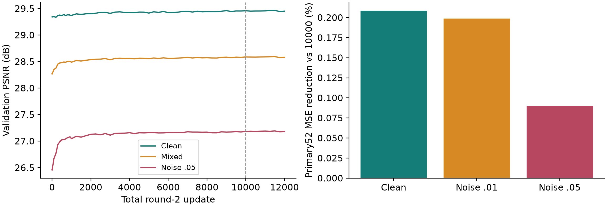
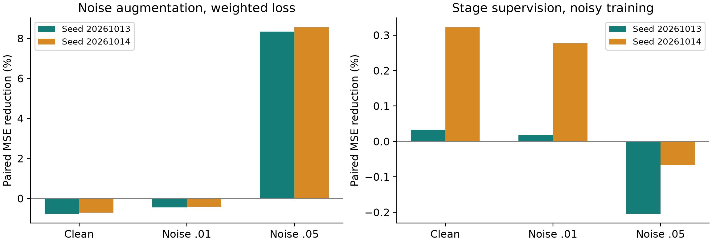
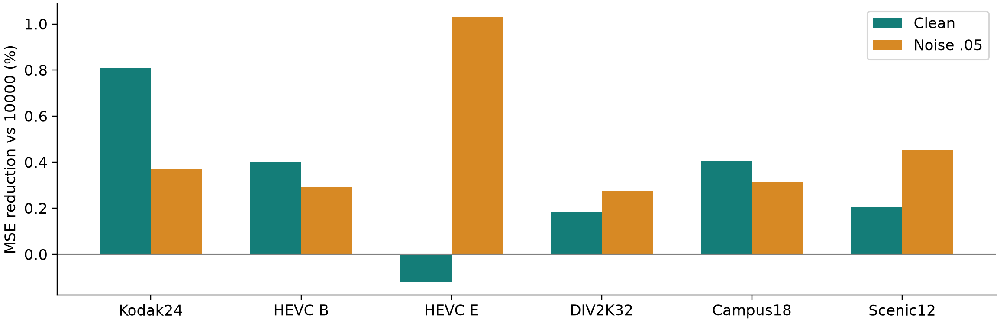
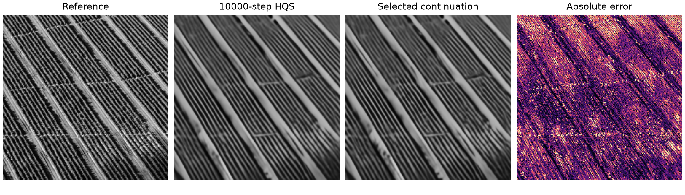

# Single-Pixel Reconstruction: Controlled HQS Fine-Tuning and Training Ablations

Zicong Luo (522026230043), Shuhao Yang (502026230083), Yubowen Li (502026230092)

## Abstract

We study image reconstruction from matched simulated single-pixel measurements. Preserved experiments compare adjoint reconstruction, DCT-FISTA and released HQS/ADMM ProxUnroll models. This extension continues fixed-operator HQS from 10000 to 12000 updates and runs a two-by-two ablation of training measurement noise and intermediate-stage supervision, with two training seeds and 800 updates per arm. A previously locked 52-image DIV2K project holdout evaluates all selected and fixed-budget endpoint states. Validation selects step 11500 for the continuation. At clean 10% sampling, its mean MSE reduction is +0.21% versus the prior selected 10000-step state; at relative noise .05 the reduction is +0.09%. Negative reductions mean higher error. All regressions and seed-specific effects are retained.

## 1. Problem and Prior Work

Single-pixel imaging records spatially encoded integrated responses [1]. We simulate this acquisition from existing 256 x 256 grayscale images. The task is underdetermined at low sampling rates, so reconstruction combines measurement consistency and image priors. ProxUnroll [2] provides the architecture and official pretrained weights. Our contributions are a common measurement/metric contract, reproducible external evaluations, bounded fixed-matrix fine-tuning and controlled training ablations; we do not claim a new architecture.

## 2. Common Reconstruction Contract

The separable forward model is Y = H X W<super>T</super> + E. Adjoint reconstruction uses H<super>T</super> Y W. DCT-FISTA [3] uses gradient descent, DCT soft thresholding and acceleration for 200 iterations; lambda .001 was chosen by independent original validation before the external tests. HQS alternates measurement correction with a learned restorer; ADMM adds a dual variable. The supplied six-stage restorer uses convolution, window attention and memory within one image, without previous/future video frames.

All methods receive identical common-MAT factors, measured values and noise realizations. Nominal clean sampling rates are 1%, 4%, 10%, 25% and 50%; actual row counts are recorded. At 10%, zero-mean Gaussian noise has standard deviation .01 or .05 times clean measurement RMS. Three fixed measurement seeds repeat noisy conditions. Predictions are clipped to [0,1] for PSNR/SSIM with data_range 1, without border cropping. Primary metrics precede PNG quantization.

Percent improvement means 100(1 - mean candidate MSE / mean reference MSE). It is not a percentage change in PSNR. Noise repeats average within each image; images average within a video; whole videos have equal weight within a dataset. Still-image units are originals. Training seeds and measurement-noise seeds are separate experimental units.

## 2.1. Preserved Four-Method Comparison

On the 18 Nanjing campus web photographs at clean 10% sampling, mean PSNR is 23.92 dB for adjoint, 24.60 for DCT-FISTA, 28.35 for official HQS and 28.38 for official ADMM. The neural models outperform these traditional baselines under the common contract; HQS and ADMM are close. These are previously observed regression results, separate from the new primary52 continuation and factorial tests.

## 3. Data and Test Roles

Training uses all 800 official DIV2K training originals [4]; 16 separate originals select checkpoints. Split assignment precedes random square crops, area resizing and horizontal/vertical flips. Training/validation/holdout original-source hashes are disjoint. Still photographs use the largest centered square, OpenCV RGB2YCrCb Y and INTER_AREA resize to 256 x 256, then uint8/255.

The primary set contains the 52 remaining DIV2K validation originals locked before the previous continuation. Before this experiment, completed project inference provenance was scanned for overlap; its role is recorded as previously unused project holdout. No test inference is used for checkpoint selection. Official pretraining exposure remains unknown, so project-disjoint does not imply unseen by all upstream training.

Previously observed regression inputs comprise Kodak24, eight HEVC B/E videos with three spaced raw Y frames each, DIV2K32 and 30 Nanjing web photographs, totaling 110 images. The 18 campus and 12 scenic photographs have external authors and documented licenses; they are team-curated, not team-captured. HEVC is 8-bit planar YUV420 with checked dimensions/byte counts and fixed indices 0, floor(N/3), floor(2N/3). Stored Y/255 is retained because trustworthy range metadata are absent.

## 4. Matched Factorial Ablations

| Arm | Noise | Stage loss | Updates |
| --- | --- | --- | --- |
| on/weighted | on | .01 x5 / .95 | 800 x2 |
| off/weighted | off | .01 x5 / .95 | 800 x2 |
| on/final | on | final 1 | 800 x2 |
| off/final | off | final 1 | 800 x2 |

All four arms start from the same official HQS weights with fresh Adam at 1e-5, batch one and FP32. Seeds 20261013 and 20261014 each run every arm for 800 updates. Within each seed, original order, crops, flips, sampling rates and proposed noise draws are identical. Disabling noise sets only its amplitude to zero. All six H/W sensing parameters remain frozen.

Weighted supervision is direct-ground-truth RMSE with .01 on each of five intermediate outputs and .95 on the final output. Final-only supervision uses weight 1 on the final output, preserving total loss weight. This tests short adaptation from official weights; it does not isolate every change responsible for the earlier 10000-step result.

Validation uses 16 originals, rates 10%/25% and noise 0/.01/.05, every 200 ablation updates. Mixed PSNR selects the highest eligible checkpoint, with clean validation at least initialization minus .03 dB. Initialization is a candidate. Selected best and equal-budget last are evaluated separately.

## 5. Continuation with the Same Update Rule

Continuation restores the actual step-10000 model, Adam, scheduler, RNG, selection history and best candidate. It adds 2000 updates under the unchanged noisy weighted-RMSE recipe, with validation every 250 steps. This is a training-length comparison, distinct from the official-weight factorial adaptation.

Actual audits confirm 12000 optimizer updates in the inherited trajectory and 800 in every ablation arm; six sensing factors are unchanged. Validation selects continuation step 11500. CUDA prechecks show 2+1 updates equal uninterrupted 3, and old/new drivers give identical 5-to-6 updates for parameters, Adam, scheduler, RNG, crops, losses and validation.

## 5.1. Primary Holdout Results

| Condition | vs official | vs 10000 | PSNR / SSIM |
| --- | --- | --- | --- |
| Clean | +4.12% | +0.21% | 28.02 / 0.845 |
| Noise .01 | +3.89% | +0.20% | 27.68 / 0.839 |
| Noise .05 | +12.33% | +0.09% | 25.92 / 0.783 |

Table 1 reports MSE reductions at 10% sampling, with positive values indicating lower error. The continuation uses 53.1 minutes; all new formal training arms total 212.4 GPU-minutes. Maximum allocated memory is 10.84 GiB. Resources are verified RTX 3090 GPUs in server244 container luozc_mlvc, with project-local Python 3.11.11 and Torch 2.6.0+cu124.

## 6. Effects of Noise and Stage Supervision

| Seed / test | Noise effect | Stage effect |
| --- | --- | --- |
| 20261013 / clean | -0.77% | +0.03% |
| 20261013 / noise .05 | +8.34% | -0.20% |
| 20261014 / clean | -0.71% | +0.32% |
| 20261014 / noise .05 | +8.56% | -0.07% |

Table 2 compares fixed-budget endpoints on primary52. Noise effect compares noise-on with noise-off under weighted loss. Stage effect compares weighted with final-only loss under noisy training. Each comparison holds seed, original order, crops, sampling and budget fixed. Positive values indicate lower mean MSE when adding that factor.

At clean 10%, adding training noise with weighted loss gives -0.74% mean, -0.77% to -0.71% across seeds; at test noise .05 it gives +8.45% mean, +8.34% to +8.56% across seeds. Adding stage supervision with noisy training gives +0.18% mean, +0.03% to +0.32% across seeds on clean measurements and -0.14% mean, -0.20% to -0.07% across seeds at noise .05.

The complete factorial analysis also compares noise under final-only loss and stage supervision under clean training. Main effects average raw-MSE benefits over the other factor; interaction is noise benefit with weighted loss minus noise benefit with final-only loss. These raw effects share official-MSE normalization in percent points, rather than mixing reductions with different denominators. Two-seed mean noise main / stage main / interaction effects are -0.80, +0.09, +0.17 percent points on clean data and +8.35, -0.07, -0.09 at noise .05.

Selected-best effects and endpoint effects remain separate in CSV. Every seed is reported alongside the two-seed mean and range; two training seeds are too few for strong significance claims. A negative result or an initialization-selected arm is retained. We do not reinterpret related measurement repetitions as independent training replications.

## 7. Regression and Complete Evidence

| Dataset | Clean | Noise .05 |
| --- | --- | --- |
| Kodak24 | +0.81% | +0.37% |
| HEVC B | +0.40% | +0.29% |
| HEVC E | -0.12% | +1.03% |
| DIV2K32 | +0.18% | +0.28% |
| Campus18 | +0.41% | +0.31% |
| Scenic12 | +0.21% | +0.45% |

For each regression dataset, Table 3 preserves clean and stronger-noise results at 10% sampling. Kodak, HEVC, DIV2K32 and Nanjing photographs were already inspected in previous work; they are regression evidence, not newly unseen confirmation. Each video has its own table, and no long sequence dominates the dataset mean. The original regression inference reached its 90-minute cap after 88 complete originals. A separate bounded run completed the remaining 22 on an idle RTX 2080 Ti; original failures and partial CSVs were retained. All merged floating metrics were rechecked. Within every original all states share hardware and inputs; mixed-hardware timings are not treated as one-GPU speed results.

The primary set saves 11440 metric rows for selected and endpoint states; regressions save 14520 rows for selected ablation states and continuation views. All 25960 floating reconstructions are independently checked against stored metrics, with data/weight/matrix/source and regenerated measurement hashes. Raw CSV, stage metrics, configurations, versions, arrays and display images remain available.

On primary52, selected continuation increases MSE versus the prior selected state in 191/572 measurement conditions. All per-image deltas and every negative comparison are retained, across references and factorial contrasts. Sample illustration selection occurs after testing for diagnosis, not model selection.

## 8. Failure Analysis and Limits

The diagnostic uses DIV2K source 0897.png with fixed center-square Y preprocessing. Candidate hqs_12000 has per-condition PSNR change -0.210 dB and SSIM change -0.0187. The error map locates spatial mismatch; it does not identify a unique training cause. The selected continuation is illustrated unless it never regresses, in which case the endpoint is explicitly labeled. All headline values use floating outputs.

The factorial design controls two recipe factors during 800-step adaptation. It does not separately test expanded data coverage, all learning-rate choices, architecture, sensing co-learning or the complete earlier training history. The unchanged-recipe continuation answers a different question. Two seeds and a modest image set limit generalization; upstream public-image exposure is unaudited.

Cropped grayscale software simulation omits physical masks, detector calibration, photon statistics and full-color acquisition. Video frames are reconstructed independently without temporal inputs. Network-collected photos do not satisfy a claim of team capture. The recorded evidence supports condition-specific benefits and regressions rather than universal superiority.

## 9. Reproducibility and AI Disclosure

Code, locks and small frozen evidence are versioned. The experiment root is /workspace/ProxUnroll-main/runs/hqs_ablation_20261013. Official weights and MAT factors, selected best.pth, recovery last.pth, logs/exit codes, pairing audits and all test outputs have SHA-256 provenance. Original reports and experiments remain unchanged. Codex assisted code, execution, analysis and materials; students must verify results, understand the algorithms and present them. No course-platform submission is claimed.

## References

[1] M. F. Duarte et al. Single-Pixel Imaging via Compressive Sampling. IEEE Signal Processing Magazine, 2008. DOI: 10.1109/MSP.2007.914730. [2] P. Wang et al. Proximal Algorithm Unrolling: Flexible and Efficient Reconstruction Networks for Single-Pixel Imaging. CVPR, 2025. arXiv:2505.23180. Official code: github.com/pwangcs/ProxUnroll. [3] A. Beck and M. Teboulle. A Fast Iterative Shrinkage-Thresholding Algorithm for Linear Inverse Problems. SIAM J. Imaging Sciences, 2009. DOI:10.1137/080716542. [4] E. Agustsson and R. Timofte. NTIRE 2017 Challenge on Single Image Super-Resolution: Dataset and Study. CVPR Workshops, 2017.
